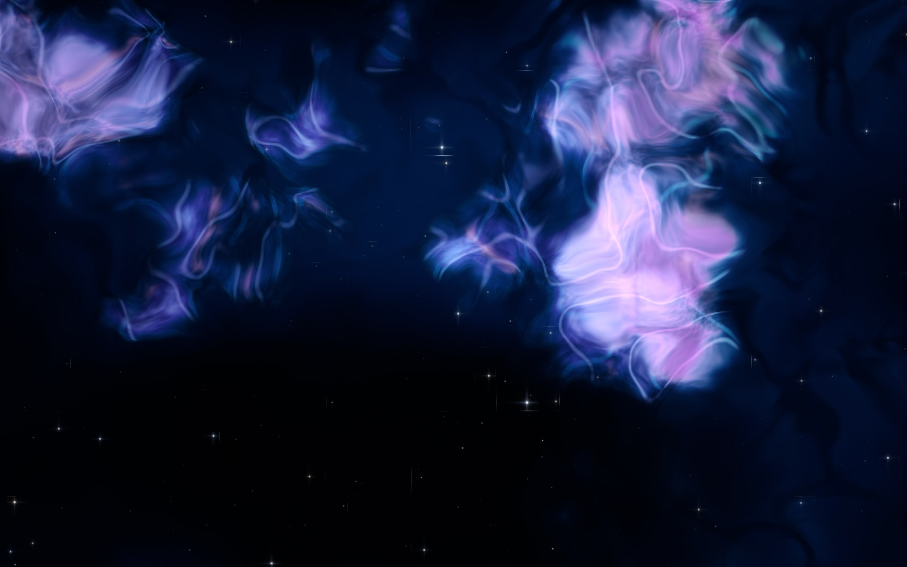
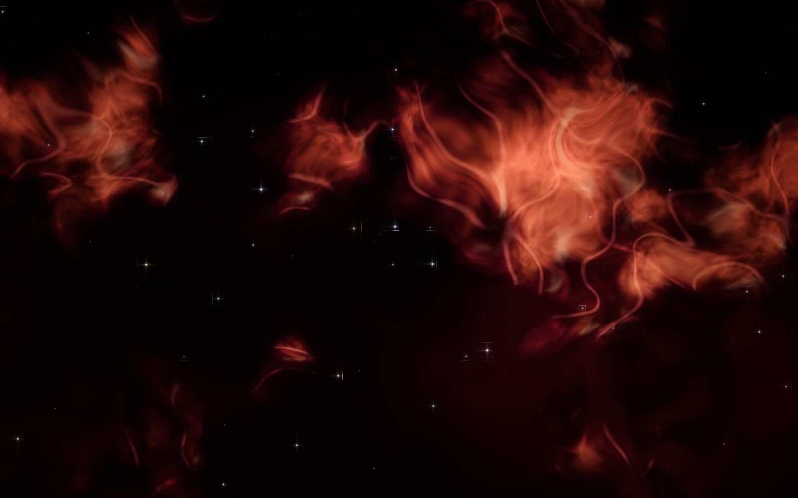
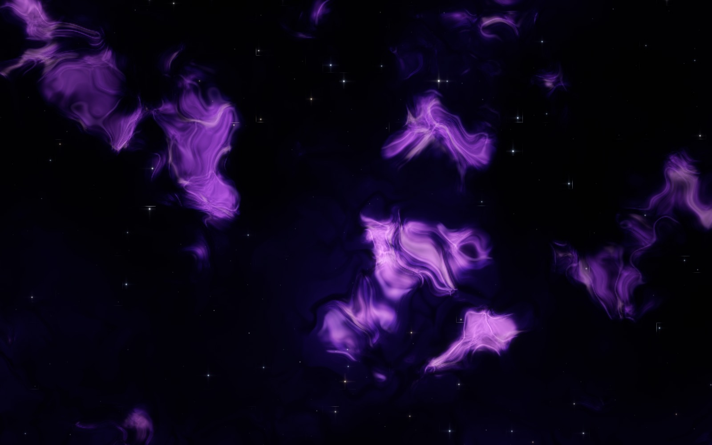
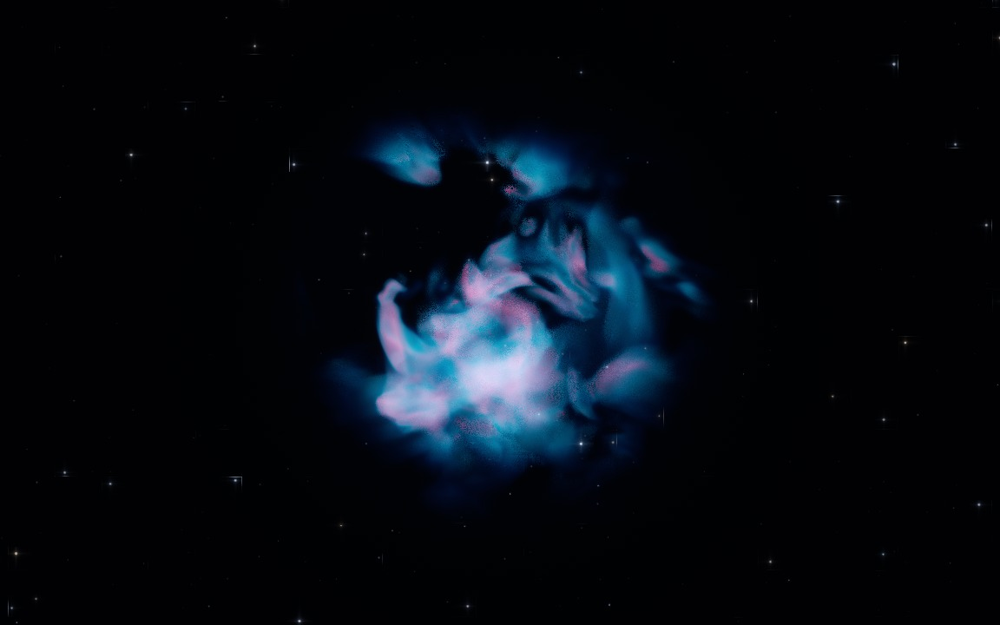

# Nebula

[](https://github.com/caleblin125/nebula/actions/workflows/ci.yml)


[](LICENSE)

A seeded procedural nebula generator rendered with WebGL2 and GLSL ES 3.00.
A multi-scale density field is shaped into clouds, dust lanes and filaments;
emission and a palette then turn that field into an image. A raymarched mode
samples the same model as a volume.

No rendering libraries or frameworks — just TypeScript, Vite and raw GLSL.



## Highlights

- **Deterministic.** A seed plus a parameter set always produces the same still
  image; animation is a pure function of time.
- **Structure first.** Domain-warped fBm, zero-crossing filament iso-lines, soft
  thresholds and spatial masks build density. Dust is a separate absorption term.
  Color is derived downstream, never sampled from noise.
- **Layered light.** Palette-driven emission, bright cores, a broad envelope,
  sparse stars, vignette, ACES tone mapping and a three-pass bloom.
- **Two renderers.** A fast screen-space 2D field and a raymarched volume with
  front-to-back compositing.
- **Controllable.** Six presets, live controls and JSON export/import. The URL
  mirrors the seed, the matched preset and the render mode.
- **Measured.** A built-in benchmark, self-tests and adaptive quality, with
  numbers in [docs/performance.md](docs/performance.md).

## Quick start

```bash
npm install
npm run dev      # http://localhost:5183/
npm run build    # type-check + production build into dist/
npm run preview
```

Node 20 or newer. A WebGL2 browser with hardware acceleration is required; if
WebGL2 is unavailable the page shows a notice instead of failing silently. All
visuals are generated at runtime — there are no image assets.

## Gallery

| | |
|---|---|
|  |  |
| Carina Core — dense warm core | Veil Filaments — thin teal tendrils |
|  |  |
| Ember Bloom — ionized core in dust | Violet Hollow — magenta shells around a void |
|  |  |
| Cold Drift — faint ice haze | 3D volume — raymarched Orion field |

All images were rendered at 1600×1000 with the bundled capture harness. The
volume image uses the volume pipeline's 0.72 internal scale, so its saved buffer
is 1152×720.

## Controls

Primary controls: density, cloud scale, warp strength, octaves, emission and
animation speed. Advanced controls add filament detail, rotation, lacunarity,
persistence, exposure, star density, vignette, render scale and volume steps.

- **Presets** replace the look but keep the renderer, render scale, adaptive
  quality, volume step count and pause state.
- **New seed** / **R** picks a fresh seed; **Reset** restores defaults.
- **Export/Import JSON** round-trips every parameter, including pipeline
  settings.
- **Space** freezes or resumes time.

URL parameters:

| Parameter | Meaning |
|---|---|
| `?seed=65521` | override the seed |
| `?preset=orion-deep` | start from a preset |
| `?mode=volume` | start in the raymarched mode |
| `?static=1` | start paused |
| `?debug=density\|cloud\|filament\|shape\|mask` | density-field debug view (bloom bypassed) |
| `?ui=0` | hide the masthead, telemetry and controls for clean captures |

## How it works

1. **Density.** Seeded 2D/3D gradient noise feeds fBm and ridged fBm. A
   low-frequency **sheet** carries the mass from the unwarped coordinate, while
   two levels of domain warp distort the detail. Density moves a soft threshold,
   so raising it thickens existing clouds rather than filling negative space.
2. **Filaments and dust.** The bright network is the zero-crossing iso-line of
   two crossing noise fields, so it is thin and connected. Dust comes from a
   separate crease family and absorbs light from behind instead of deleting gas.
3. **Emission.** Turbulence, erosion and lace modulate the cloud body. Emission
   is derived from structured gas only; a `hot` term pushes dense cores toward
   the bright palette stop.
4. **Presentation.** Five-stop linear palettes, ACES tone mapping, sRGB
   encoding, ordered dithering and a quarter-resolution bloom.
5. **Volume.** A camera ray is intersected with a cube and marched front to
   back. Gas and dust are integrated separately with step-length extinction, so
   the image does not change with the step count. Empty space is skipped and a
   hue-preserving shoulder keeps core highlights from clipping.

The full model — equations, thresholds and the compositing loop — is in
[docs/rendering.md](docs/rendering.md).

## Project layout

```text
src/
├── main.ts                  boot, URL state, telemetry, shortcuts
├── renderer/
│   ├── Renderer.ts          pipeline, sizing, uniforms, adaptive quality
│   ├── ShaderProgram.ts     compile/link + #include resolver
│   ├── FullscreenTriangle.ts
│   ├── Uniforms.ts          typed uniform setter with caching
│   ├── PostFx.ts            scene target + bloom passes
│   └── PerformanceMonitor.ts frame stats + GPU timer queries
├── shaders/
│   ├── vertex.glsl          fullscreen triangle
│   ├── nebula.frag          2D composition
│   ├── volume.frag          raymarched volume
│   ├── noise.glsl           2D/3D gradient noise, fBm, ridged noise
│   ├── density.glsl         shared density model
│   ├── color.glsl           palette ramp, emission, ACES, sRGB
│   ├── stars.glsl           procedural star field
│   └── post.frag            bloom bright/blur/composite
├── simulation/
│   ├── Parameters.ts        schema, defaults, palettes, clamping, JSON
│   └── Presets.ts           curated looks
├── ui/Controls.ts           panel generated from the schema
├── utils/Random.ts          seed normalization and randomization
└── bench.ts                 benchmark, self-test suite, visual compare, capture

docs/                        rendering model, measurements, change report, plan
bench.html                   benchmark, test and capture harness
```

Parameters are the only thing the renderer consumes. The UI mutates them and
the renderer reads them; the two never share DOM or GL state. Shaders are
imported with Vite's `?raw` and assembled by `ShaderProgram`, so GLSL stays in
`.glsl` files.

## Performance

On the integrated GPU used for development (Intel Graphics, ANGLE D3D11), the
2D field costs **~26.6 ms/frame at 1080p** (~38 fps) at full resolution, and the
volume costs **~69.6 ms/frame at 1080p** (~14 fps) at its 0.72 internal scale
(1382×778 buffer, 48 steps). Adaptive quality is on by default and settles near
0.6–0.7 scale for 2D and 0.55 for the volume.

Full tables, the measurement method and adaptive-quality behavior are in
[docs/performance.md](docs/performance.md).

## Reproducibility

A seed plus a parameter set determines the still image. Animation depends only
on elapsed time and the animation speed, so pausing freezes the exact frame.
There is no per-frame randomness. Floating-point results can differ in the last
bits between GPU vendors, but the structure is seed-defined.

## Development

```bash
npm run bench    # start Vite and open /bench.html
```

The harness renders at a fixed buffer size and measures draw cost with
`gl.finish()` plus a pixel readback, independent of display refresh. Useful
routes:

```text
bench.html?w=1920&h=1080&preset=orion-deep   # draw-cost benchmark
bench.html?mode=volume&w=1280&h=720           # volume benchmark
bench.html?test=suite                         # 53 self-checks
bench.html?test=compare&ref=orion-deep-2d.png&preset=orion-deep&w=640&h=400
bench.html?test=io                            # JSON round-trip + clamping
bench.html?test=contextloss                   # forced context loss and restore
bench.html?test=shot&w=1600&h=1000&preset=carina-core&name=shot.jpg
```

The self-test suite and the visual-regression comparison run in the page and need
no browser automation; `test=compare` reads lossless PNG references from
`screenshots/reference/` through the dev server. Shot mode writes through a
development-only Vite endpoint into `screenshots/`; production builds do not
include it.

See [CONTRIBUTING.md](CONTRIBUTING.md) for the checks and conventions, and
[docs/development-plan.md](docs/development-plan.md) for the build log and
validation notes.

## Known limitations

- The volume is expensive on integrated GPUs. Lower **Volume steps** (from the
  default 48) and **Render scale** first; adaptive quality bottoms out at 0.55.
- Volume close-ups show stable stochastic grain from the per-pixel ray offset.
- Bloom works in 8-bit display space. The volume's highlight shoulder preserves
  hue and structure, but this is deliberate and cheap, not HDR-correct.
- The 2D field is screen-space: rotation and warp are 2D effects with no
  parallax.
- Stars are a procedural screen-space layer, not a skybox, so they do not rotate
  with the volume camera.
- `EXT_disjoint_timer_query_webgl2` is not exposed by every driver; when absent
  the HUD shows `gpu n/a` and adaptive quality uses frame time.
- Emission, extinction and step counts are artistic controls, not a physically
  calibrated radiative-transfer model.
- UI state persists only through the URL and imported JSON.

## License

[MIT](LICENSE) © 2026 Caleb Lin
