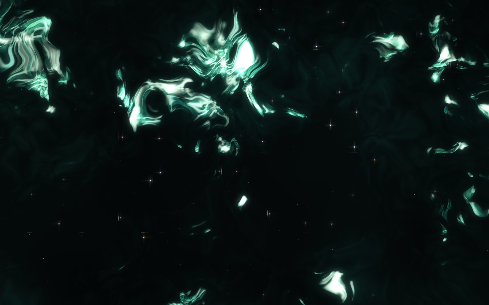
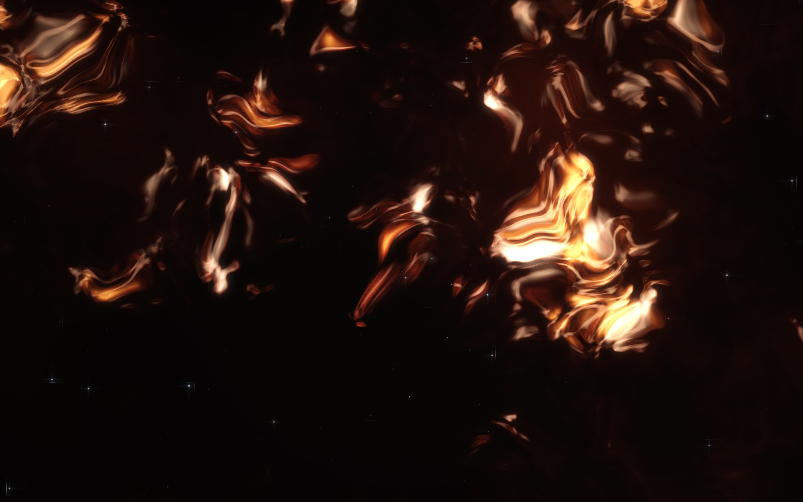
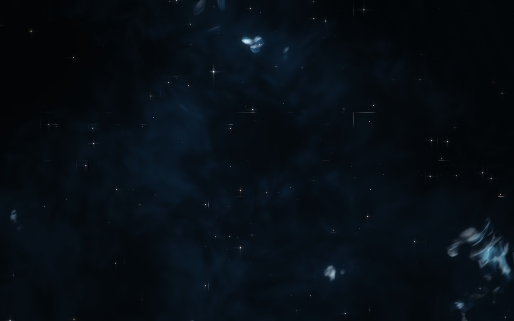

# Nebula

A procedural nebula generator built on WebGL2 and GLSL ES 3.00. Density, color
and light are separate stages: a seeded multi-scale density field is shaped into
clouds and filaments, then emission and palette mapping turn that field into the
image. A raymarched 3D mode samples the same idea as a volume.

No rendering libraries or frameworks — the project is TypeScript, Vite and raw
GLSL.


## Quick start

```bash
npm install
npm run dev      # http://localhost:5183/
npm run build    # type-check + production build into dist/
npm run preview
```

Requires a WebGL2 browser (Chrome/Edge/Firefox/Safari with hardware
acceleration). If WebGL2 is unavailable the page shows a notice instead of
failing silently.

## What is in the box

- Seeded, deterministic field: the same seed and parameters always produce the
  same still image.
- Multi-scale density with domain warping, ridged filaments, dust lanes, an
  ambient envelope and pixel-scale lace.
- Palette-driven emission with bright cores, a broad background glow, sparse
  stars, vignette and filmic tone mapping.
- Slow animation (warp drift, noise translation, optional 2D rotation) and a
  freeze toggle.
- Six curated presets, plus JSON export/import and URL-driven state.
- A three-pass bloom post-process at quarter resolution.
- A raymarched volumetric mode with front-to-back compositing.
- A benchmark and self-test harness (`bench.html`).

## Screenshots

| | |
|---|---|
|  |  |
| Carina Core — dense warm core | Veil Filaments — thin teal tendrils |
|  |  |
| Ember Bloom — ionized core in dust | Violet Hollow — magenta shells around a void |
|  |  |
| Cold Drift — faint ice haze | 3D volume — raymarched Orion field |

All images were rendered at 2160×1350 by `bench.html?test=shot` (the volume
image uses the volume pipeline's 0.72 internal scale, so it is 1555×972).

## Controls

Primary controls: density, cloud scale, warp strength, octaves, emission and
animation speed. Advanced controls add filament detail, rotation, lacunarity,
persistence, exposure, star density, vignette, render scale and volume steps.

- **Presets** replace the look but keep the renderer, render scale, adaptive
  quality, volume step count and pause state.
- **New seed** / **R** picks a fresh seed; **Reset** restores defaults.
- **Export/Import JSON** round-trips every parameter, including pipeline
  settings.
- **Space** freezes/unfreezes time.

URL parameters:

| Parameter | Meaning |
|---|---|
| `?seed=65521` | override the seed |
| `?preset=orion-deep` | start from a preset |
| `?mode=volume` | start in the raymarched mode |
| `?static=1` | start paused |
| `?debug=density\|cloud\|filament\|shape\|mask` | density-field debug view (bloom bypassed) |
| `?ui=0` | hide the masthead, telemetry and controls for clean captures |

## Architecture

```
src/
├── main.ts                  boot, URL state, telemetry, shortcuts, context notices
├── renderer/
│   ├── Renderer.ts          pipeline, sizing, uniforms, adaptive quality
│   ├── ShaderProgram.ts     compile/link + a small #include resolver
│   ├── FullscreenTriangle.ts
│   ├── Uniforms.ts          typed uniform setter with caching
│   ├── PostFx.ts            scene target + bloom passes
│   └── PerformanceMonitor.ts frame stats + GPU timer queries
├── shaders/
│   ├── vertex.glsl          fullscreen triangle
│   ├── nebula.frag          2D composition
│   ├── volume.frag          raymarched volume
│   ├── noise.glsl           2D/3D gradient noise, fBm, ridged noise
│   ├── density.glsl         shared density model (2D and 3D)
│   ├── color.glsl           palette ramp, emission, ACES, sRGB
│   ├── stars.glsl           procedural star field
│   └── post.frag            bloom bright/blur/composite
├── simulation/
│   ├── Parameters.ts        schema, defaults, palettes, clamping, JSON
│   └── Presets.ts           curated looks
├── ui/Controls.ts           panel generated from the schema
├── utils/Random.ts          seed normalization and randomization
└── bench.ts                 benchmark, self-tests, screenshot capture
```

`Parameters` is the only thing the renderer consumes; the UI only mutates
parameters and the renderer only reads them. Shaders are imported with Vite's
`?raw` and assembled by `ShaderProgram`, so GLSL stays in `.glsl` files.

## Mathematical model

### Noise and fractals

All noise is analytic and hash-based, with no RNG state and no noise textures.

- `gnoise2`: quintic-interpolated gradient noise with a 16-entry unit-gradient
  table and an integer cell hash.
- `gnoise3`: the same construction on a 3D lattice with the 12 cube-edge
  gradients. `gnoise3v` returns three independent values from one lattice pass
  and is used by the volume warp.
- `fbm2` / `fbm3`: normalized sums with a rotation between octaves to break
  axis alignment.
- `ridged2` / `ridged3`: `1 - |N|`, squared and weighted by the previous
  octave, producing creases rather than blobs.

### 2D density

For screen coordinate `p`:

1. Two-level domain warp: `w = p + k·(A(p), B(p))`, with the second level at a
   higher frequency and a smaller amplitude. Slow time drift animates each
   level independently.
2. Large structure is sampled from the **unwarped** coordinate so cloud masses
   stay coherent; medium and fine detail live in the warped domain.
3. A signed `shape` combines large/medium/fine/micro fields. Density moves a
   soft threshold rather than scaling the noise:
   `cloud = smoothstep(t0, t0 + band, shape)`. Raising density thickens existing
   clouds instead of filling negative space.
4. Turbulence and clump masks multiply the cloud body; a high-frequency erosion
   field feathers its edges.
5. Two crossing ridged fields carve dust lanes and produce the bright filament
   layer; a third, stretched ridge field supplies pixel-scale lace.
6. A low-frequency envelope keeps faint gas around the resolved structure, and
   a spherical mask (3D mode) or vignette (2D) removes hard boundaries.

### Emission and color

Density is never mapped directly to RGB as noise. The shader derives:

- `emission = f(cloud, filament, lace, density²)` so only structured gas glows;
- a `hot` ionization term that shifts dense cores toward the bright palette
  stop;
- a five-stop sRGB palette converted to linear on the CPU, so interpolation is
  physically sensible;
- a dark, noise-dithered background, sparse stars, vignette and ACES filmic tone
  mapping, then sRGB encoding and ordered dithering against banding.

Bloom is a separate three-pass display-space effect: bright extract +
4× downsample, two separable 9-tap blurs at quarter resolution, then
`scene + bloom * strength`. Working in display space avoids an HDR intermediate
at the cost of slightly clipping very bright cores before they bloom. The 2D
field uses `strength 0.9 / threshold 0.32`; the volume uses
`0.42 / 0.52`, because front-to-back integration already builds a broad bright
core and the stronger profile flattened it to a white plate.

### Volume

The camera ray is intersected with a cube, then marched front to back:

```
T = 1
for each sample:
    σ = density(p)
    α = 1 - exp(-k σ Δs)
    C += T α emission(σ) Δs
    T *= 1 - α
```

Emission is scaled by the step length, so the image does not brighten when the
step count rises; a constant folded into the source keeps the original 56-step
calibration. Empty samples advance 2.2× faster, samples outside the gas sphere
return immediately, the ridge field is skipped when the base shape cannot
support a filament, and the loop exits when transmittance drops below 0.012.
A hue-preserving shoulder compresses only the top of the accumulated radiance
(`peak > 0.7`), so a dense core stays a coloured nucleus instead of clipping to
flat white before bloom. The ray offset is a per-pixel hash (not interleaved
gradient noise, whose 4×4 weave was visible across smooth gradients). The volume
currently uses one warp octave, up to five base octaves and three medium
octaves; these limits were chosen from measurements, not guessed.

## Reproducibility

A seed plus a parameter set determines the still image. Animation is a pure
function of elapsed time (`uTime`) plus the animation speed, and pausing stops
time. There is no per-frame randomness in density or color; the volume's
per-pixel sample offset depends on the pixel and seed only, so it is stable when
frozen. Floating-point results can differ in the last bits across GPU vendors,
but the structure is seed-defined.

## Performance

Measured with the bundled harness on:

- **GPU:** Intel Graphics (0xA7AC), ANGLE Direct3D11
- **Browser:** Chromium-based, Windows
- **Method:** `bench.html` forces the WebGL buffer to an exact pixel size,
  draws frames synchronously with `renderer.renderOnce()`, and synchronizes each
  sample with `gl.finish()` + a 1-pixel `readPixels`. This measures draw cost
  independently of the display refresh rate. Adapted quality is **off** for the
  table, so these are full-resolution worst cases.

### 2D field (full resolution)

| Buffer | Draw cost (median) | p95 | Draw ceiling |
|---|---:|---:|---:|
| 1280×720 | 15.1 ms | 18.9 ms | ~66 fps |
| 1920×1080 | 33.1 ms | 38.1 ms | ~30 fps |
| 2560×1440 | 55.7 ms | 60.5 ms | ~18 fps |

Estimated noise cost: **50 gradient-noise evaluations/pixel** at the default six
octaves (the HUD reports this live, including the warp and all detail fields).

### Volume (0.72 internal scale)

| Requested | Internal buffer | Draw cost (median) | Draw ceiling |
|---|---:|---:|---:|
| 1280×720 | 922×518 | 60.4 ms | ~17 fps |
| 1920×1080 | 1382×778 | 133.1 ms | ~8 fps |
| 2560×1440 | 1843×1037 | 237.6 ms | ~4 fps |

Estimated cost: **~308 noise evaluations/pixel** at 56 steps, after empty-space
skipping and early termination. Shader compilation is 15–65 ms for the whole
program set on a warm driver cache; a cold cache can take over a second.

**These are integrated-graphics numbers.** A discrete GPU has far more
headroom. The volume is intentionally the expensive mode; the 2D field is the
default and the one tuned for interactive use on laptops.

### Adaptive quality

`adaptiveQuality` (on by default) targets ~21 ms of GPU cost (or ~22 ms of
frame time when the GPU timer is unavailable). It scales the render buffer
between 1.0 and 0.55, solving for the scale that reaches the target rather than
stepping blindly. When a real GPU timer is present it can also recover
resolution; with only vsync-capped frame time it scales down and waits for a
mode/parameter change, which avoids oscillation. On this iGPU, 1080p 2D settles
around 0.6–0.7 scale and the volume around 0.55 (≈25 fps).

The telemetry HUD shows FPS, frame time, GPU time when the timer extension
reports one, buffer resolution, noise evaluations per pixel and the active mode.

### Benchmark and tests

```text
/bench.html?w=1920&h=1080&preset=orion-deep          # draw-cost benchmark
/bench.html?mode=volume&w=1280&h=720                # volume benchmark
/bench.html?test=io                                 # JSON round-trip + clamping
/bench.html?test=contextloss                        # forced loss/restore
/bench.html?test=shot&w=2160&h=1350&preset=carina-core&name=shot.jpg
```

The shot mode posts the encoded frame to a development-only Vite endpoint and
writes it into `screenshots/`, which is how the images above were produced.

## Known limitations

- The volume is costly on integrated GPUs. Lower **Volume steps** (24–40) and
  **Render scale** first; adaptive quality can only go down to 0.55.
- Volume close-ups show stochastic grain from the per-pixel ray offset. It is
  stable when frozen but is not free.
- Bloom operates in 8-bit display space, so the brightest cores are clipped
  before the blur; the volume's highlight shoulder keeps hue and structure, but
  this is deliberate and cheap, not HDR-correct.
- The 2D field is screen-space. Rotation and warp are 2D effects; there is no
  parallax or depth.
- Stars are a procedural screen-space layer, not a real skybox; they do not
  rotate with the volume camera.
- `EXT_disjoint_timer_query_webgl2` is not exposed by every driver. When it is
  absent the HUD shows `gpu n/a` and adaptive quality uses frame time.
- Emission, extinction and step counts are artistic controls, not a physically
  calibrated radiative-transfer model.
- Determinism is exact for the seed/parameter mapping, but GPU floating-point
  rounding can differ slightly between vendors.
- There is no persistence of UI state beyond the URL and imported JSON.

## License

No license file is included; treat this as a personal/portfolio project.
